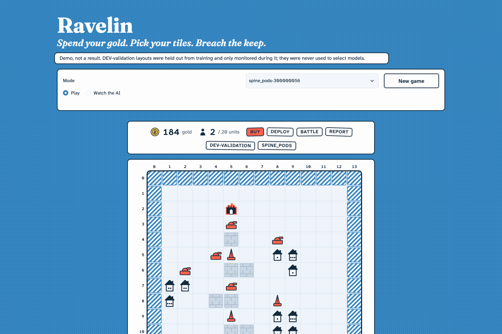
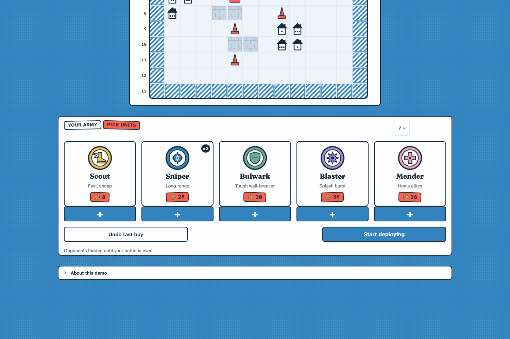

# Ravelin

A small tactics game on a 14x14 board, and a reinforcement-learning study of how well agents play it.

Play it: https://ravelin.streamlit.app (placeholder until the app is deployed)

## What it is

You are the attacker. You spend 240 gold on a small army of five unit types, place the units on the border of the board, and a deterministic simulator runs the battle against an automated base. Your result is a score: 0.6 times the share of building value destroyed, plus 0.4 if the core falls (a "breach"). The same game is played by learned agents, scripted baselines and a search baseline, so you can compare your own run with theirs on the same layout.

## How to play

- **Buy.** Choose units (Scout, Sniper, Bulwark, Blaster, Mender) until the gold is gone or you press End buy.
- **Deploy.** Click a free border tile to place the selected unit. Illegal moves show a message and change nothing.
- **Battle.** Press Wait to start the simulation; replay it tick by tick.
- **Report.** After the battle, "Show report" reveals how the agents, BestSingle and Oracle did on the same layout. The Watch the AI mode steps through an agent's decisions with its top five actions, a value estimate and a deploy heatmap.

## What the AI is

- **PPO** (maskable, with action masks) trained on 150 layouts; **PPO+D4** is the same with rotation and reflection augmentation; **DDQN** is a value-based learner. Each is trained with 10 seeds; the app shows seed 0.
- **TTA** (test-time augmentation): the board is shown in all 8 rotations and reflections, the answers are mapped back and averaged, then the best legal action is taken.
- **BestSingle**: a scripted army of one unit type (8 Snipers). **Greedy** and **Random** are the other scripted baselines.
- **Oracle**: a fixed-budget search (about 400 simulations) that uses the simulator. It is an upper reference, not the optimum.

## Key findings

Evaluation was a single run on 120 held-out layouts (60 familiar, 60 of a layout family never seen in training), 10 seeds per learner. No learned policy beats a fixed single-type army on breach rate: BestSingle breaches 0.700 of familiar layouts against 0.34-0.39 for the learners. On score the learners are no better than BestSingle on familiar layouts and worse on the transfer family. Test-time augmentation helps every learner. 27 of 64 primary checks hold, with no multiplicity correction and wide intervals.

Breach rate / mean score (from [docs/RESULTS.md](docs/RESULTS.md)):

| Condition | Familiar: breach | Familiar: score | Transfer: breach | Transfer: score |
|---|---|---|---|---|
| Random | 0.060 | 0.107 | 0.197 | 0.158 |
| Greedy | 0.583 | 0.338 | 0.950 | 0.600 |
| BestSingle | 0.700 | 0.381 | 1.000 | 0.666 |
| PPO plain | 0.340 | 0.437 | 0.597 | 0.517 |
| PPO+D4 | 0.348 | 0.454 | 0.635 | 0.518 |
| DDQN | 0.390 | 0.434 | 0.652 | 0.563 |
| PPO plain + TTA | 0.463 | 0.530 | 0.758 | 0.614 |
| Oracle (about 400 simulations) | 1.000 | 0.892 | 1.000 | 0.964 |

Intervals, the planner results and the per-family notes are in [docs/RESULTS.md](docs/RESULTS.md). What the study does not show is in [docs/LIMITATIONS.md](docs/LIMITATIONS.md).

## Method in brief

- **Pre-registration.** Gates, metrics and protocol were written as dated rows in the Gate changelog of [docs/SPEC_V2.md](docs/SPEC_V2.md) and committed before the step they govern.
- **Held-out FINAL.** The 120 FINAL layouts were frozen (sha256) before training and evaluated once; every access is recorded in a ledger.
- **Statistics.** 95 % hierarchical bootstrap (seeds, then layouts; 10 000 resamples); a primary comparison "holds" only if its paired interval excludes 0 in the claimed direction.

## Reproduce

    python3.11 -m venv .venv
    .venv/bin/pip install -r requirements-dev.txt
    .venv/bin/python -m pytest                                  # full suite (a few tests need the model checkpoints, see below)
    .venv/bin/streamlit run app/streamlit_app.py                # live models
    RAVELIN_DEPLOY=1 .venv/bin/streamlit run app/streamlit_app.py   # deployed mode: precomputed bundle, no torch needed

`requirements.txt` is what the deployed app needs (numpy, gymnasium, streamlit); `requirements-dev.txt` adds the research and test stack. In deployed mode "Watch the AI" reads `data/app_bundle/`, the duel uses the simulator and `data/v2/duel_cache.json`, and visitors' plays are not logged.

The three seed-0 checkpoints the app bundle was built from (`grid_ppo_plain_s0`, `grid_ppo_d4_s0`, `grid_ddqn_s0`) and a `SHA256SUMS` file are attached to the [v1.0 release](https://github.com/Roshindha/ravelin/releases/tag/v1.0); the `models_v2/` directory is not in the repository.

Rebuilding the bundle, replays and duel cache needs the trained checkpoints in `models_v2/`, which are not tracked in git; all three scripts refuse to run from a dirty tree:

    .venv/bin/python scripts/build_app_bundle.py
    .venv/bin/python scripts/make_replays.py
    .venv/bin/python scripts/build_duel_cache.py

The tables in RESULTS.md come from `results/b15/tables/`. Step-by-step history and exact commands are in [docs/dev_log.md](docs/dev_log.md).

## Repo layout

    app/            Streamlit app (game, theme, board component, bundle reader), fonts
    breachlens/     game engine and evaluation code (simulator, environment, scoring, pool, duel)
    rl/             PPO / DDQN training, test-time augmentation, planner, explainability
    scripts/        app bundle, replays, duel cache, screenshots, and the step-by-step research scripts (training grids, analysis)
    data/           frozen layout pool, unit stats, duel cache, app bundle
    results/        evaluation outputs and tables
    docs/           RESULTS, LIMITATIONS, SPEC_V2, dev_log, replays, screenshots
    tests/          test suite

The Python package keeps its original internal name (breachlens) because frozen provenance hashes reference it.

## Credits

Fonts: Fraunces and Atkinson Hyperlegible (SIL Open Font License; licence files in `app/static/fonts/`).
